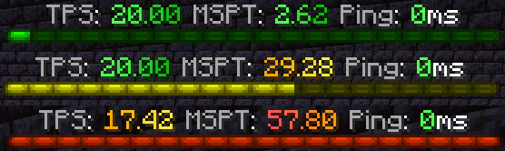

# TPS Bar

A boss bar that shows how the server keeps up: its ticks per second (TPS), the milliseconds each
tick's work takes (MSPT) and your ping.



## Using it

An operator runs `/tpsbar` to turn the bar on, and again to turn it off. The bar is theirs alone:
each player turns it on for themselves. The server remembers the choice, so the bar comes back
when they rejoin and after a restart.

The bar redraws once a second. Each number is colored by its own thresholds:

<!-- fact:addons.tps-bar.levels -->
| Number | Green        | Gold       | Red        |
| ------ | ------------ | ---------- | ---------- |
| TPS    | 19.5 or more | 15 or more | below 15   |
| MSPT   | below 25     | below 50   | 50 or more |
<!-- /fact -->

The bar takes the worse of the two colors, in green, yellow or red. It fills as MSPT approaches
<!-- fact:addons.tps-bar.tickBudget -->50<!-- /fact -->, the milliseconds a tick has at 20 TPS, so
a full bar means the server cannot keep up.

MSPT is the average over the last ten or so ticks rather than the last tick alone, so one slow
tick does not turn the bar red for a whole second. Ping shows `?` until your connection has
measured a round trip.

## Installing it

From the server console:

```text
addon install tps-bar
```

It needs JSPrismarine <!-- fact:addons.tps-bar.minServer -->0.23.0<!-- /fact --> or newer. The
pack also loads on Bedrock Dedicated Server, where `/tpsbar` says the bar needs JSPrismarine,
since only JSPrismarine gives scripts these figures.
