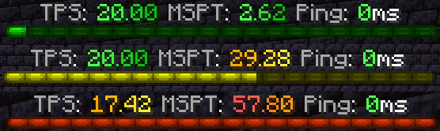

# JSPrismarine addons

Started 2026-11-20. This plan is a working document: tick slices off, and add or reshape them as
the work teaches us things.

## Goal

JSPrismarine publishes optional addons of its own, behavior packs that a server owner installs
when they want them and that never ship with the server. The first is a TPS bar: a boss bar that
shows the server's ticks per second, the milliseconds per tick and the player's ping.

What done looks like:

- Each addon is a behavior pack under `addons/<name>/` in this repository, built and released as a
  `.mcpack` with an entry in a published index.
- The server console installs, updates, lists and removes addons while the server runs:
  `addon install tps-bar`. Players, operators included, cannot run the command, so nobody adds code
  to a server from inside the game.
- `addon install <owner>/<repo>/<name>` installs an addon from another GitHub repository's
  releases, so anyone can publish addons the same way JSPrismarine does, several to a repository.
- Installed addons are tracked like dependencies: `addons.json` says what the owner asked for and
  `addons.lock.json` pins exactly what was installed, from which repository, with its hash. A
  server copied to another machine, or restored from a backup without its `addons/` folder, gets
  the same addons back.
- The docs explain how to install addons and how to write, test and publish one.
- jsprismarine.dev has an Addons section listing each addon, generated from the addons' own
  manifests.
- With the TPS bar installed, an operator runs `/tpsbar` and sees the bar in the image below; it
  stays on for them across restarts until they run `/tpsbar` again.



Out of scope for now:

- A catalog of other people's addons. Installing from another repository takes its URL; nothing
  lists or vets third-party addons.
- Resource packs. An addon is a behavior pack, so the client downloads nothing.
- Addons that need native code or Node.js modules. An addon is a script pack and runs in the
  script host's engine like any other.

## What we know

- The script host runs behavior pack scripts, and `@jsprismarine/server` holds JSP-only members a
  pack reaches through an undeclared `import()` ([guide](../guide/jsprismarine-module.md)). Today it
  only names the server and its version.
- `Server.getTPS()` and `getTPSAverages()` exist. The ticker knows each tick's duration.
- `network/BossBar.ts` and `BossEventPacket` exist, and the entity runtime already shows boss
  bars, so the client side of a bar works.
- RakNet sessions take round-trip samples (`getRoundTripSampleCount` in
  `WorkerServerSocket.worker.ts`), but no per-player ping reaches the server yet. NetherNet needs
  its own answer.
- Packs load from `content-world-packs` at startup. `/reload` restarts the scripts of the packs
  already loaded, so an installed pack needs either a restart or a reload that rereads the list.
- `ConsoleSender` is the console's command executor, so a command can refuse every other sender.

## Shape

- **`@jsprismarine/server` grows three members**, each documented by the module's fact table:
  - `performance`: the current TPS, the TPS averages and the last tick's milliseconds, read live.
  - `getPing(player)`: the player's round-trip time in milliseconds, or `undefined` when the
    transport has no sample yet.
  - `bossBars`: show, update and hide a boss bar for one player, with its text, progress (0 to 1)
    and color. A bar belongs to the pack that made it and goes away when the pack's scripts stop.
- **Addons in the repository.** `addons/<name>/` holds a pack (`manifest.json`, `scripts/`,
  `README.md`). The manifest's header carries the version; an `addon` block in
  `addons/<name>/addon.json` adds what the site and the installer need: a short description, the
  minimum JSPrismarine version and the license. A build script zips each addon into
  `<name>-<version>.mcpack`.
- **The index.** CI publishes the packs on a GitHub release tagged `addons`, kept up to date, with
  an `index.json` beside them:

  ```json
  {
      "schemaVersion": 1,
      "addons": [
          {
              "name": "tps-bar",
              "version": "1.0.0",
              "description": "Shows TPS, MSPT and ping on a boss bar.",
              "minServer": "0.23.0",
              "url": "https://github.com/JSPrismarine/JSPrismarine/releases/download/addons/tps-bar-1.0.0.mcpack",
              "sha256": "…"
          }
      ]
  }
  ```

- **Sources.** A source is a GitHub repository that publishes an `index.json` on a release, in
  the schema above; JSPrismarine's own is the default source. An addon is named
  `<owner>/<repo>/<name>`, and a bare `<name>` means the default source. Authors use the same build
  script and workflow JSPrismarine uses (slice 3 publishes them for reuse), so every source's index
  has hashes. A plain `.mcpack` URL or a local path also installs, without a source. No index
  vouches for a URL, so its first download is not checked: the console says so, and the lock
  records the hash of what was downloaded, which every later download must match. A local folder
  installs as a link to it and has no hash. The lock records its path, relative to the server's
  folder when it is inside it, so a copied server restores the link only when that path exists on
  the new machine; otherwise startup logs the addon as failed and starts without it.
- **What is installed, and what it resolved to.** Two files in the server's folder, beside
  `config.json`:

  ```jsonc
  // addons.json: what the owner asked for. Written by the command, editable by hand.
  {
      "addons": {
          "tps-bar": { "source": "JSPrismarine/JSPrismarine", "version": "^1.0.0" },
          "warps": { "source": "someone/their-addons", "name": "warps", "version": "~2.1.0" }
      }
  }
  ```

  ```jsonc
  // addons.lock.json: what was installed. Written by the command only.
  {
      "lockfileVersion": 1,
      "addons": {
          "tps-bar": {
              "source": "JSPrismarine/JSPrismarine",
              "name": "tps-bar",
              "version": "1.0.0",
              "url": "https://github.com/JSPrismarine/JSPrismarine/releases/download/addons/tps-bar-1.0.0.mcpack",
              "sha256": "…"
          }
      }
  }
  ```

  The key is the local name and the folder under `addons/`, so two sources' addons with the same
  name install side by side under different keys. The version is a semver range over the
  source's index. `sha256` is the hash of the `.mcpack` file, a URL's or an `.mcpack` path's; a
  folder's lock has none. At startup the server compares the version in each locked addon's
  `manifest.json` with the lock, without hashing the unpacked files, and downloads again from the
  lock's URL any addon whose folder is missing or holds another version. It checks that download
  against the lock's `sha256` and refuses one that no longer matches. An entry in `addons.json`
  with no lock entry, or whose source, name or range no longer allows its lock, is resolved and
  locked then, and a locked addon `addons.json` no longer names is removed.
- **The console command.** `addon list`, `addon install <name | owner/repo/name[@range] | url |
  path> [as <key>]`, `addon update [key]`, `addon remove <key>` and `addon sync`, registered for
  the console sender only. An install resolves the newest version in range, downloads it, checks
  the hash, refuses a pack whose `minServer` is newer than the server, unpacks into
  `<server>/addons/<key>/`, writes both files, and loads it. `update` resolves again within each
  range and rewrites the lock. Besides `update`, only an edit to `addons.json` that the lock no
  longer satisfies changes a locked version, when the next sync resolves it again. `sync` brings the
  folder in line with the two files, as startup does. Removing reverses each step. Loading and
  unloading go through the same path as `/reload`, extended to reread the pack list, so no
  restart is needed.
- **The TPS bar.** `/tpsbar` is a custom command the pack registers with operator permission. It
  toggles the bar for the player who runs it and remembers the choice in a player dynamic
  property. The bar's text is `TPS: <tps> MSPT: <mspt> Ping: <ping>ms`, refreshed once a second.
  Each number is green, gold or red by its own thresholds (TPS at least 19.5, at least 15, below;
  MSPT below 25, below 50, at or above), the bar is the worst of the two colors, and its progress
  is MSPT over 50, capped at 1.
- **The site.** An Addons section in the docs site lists each addon, generated from
  `addons/*/addon.json` and each addon's README, with its install command. Guide pages:
  - *Installing addons*: the console command, the two files, updating, and moving a server.
  - *Writing an addon*: the folder layout, `addon.json`, reaching `@jsprismarine/server` and
    falling back on BDS, testing with `addon install <path>` and `/reload`, and the debugger.
  - *Publishing addons*: a repository of your own with the reusable workflow, versioning, the
    index, and how owners install from it.

## How we measure

- Script-host tests drive `performance`, `getPing` and `bossBars` through a pack, with a fake
  clock for the tick durations.
- The TPS bar's tests run the pack on a test server with a manual ticker and assert the bar's
  text, color and progress for set tick durations, and that the toggle survives a restart.
- The installer's tests serve indexes and packs from a local HTTP server: a good install, two
  sources with the same addon name, a hash mismatch, a pack too new for the server, a range that
  `update` moves and one it doesn't, a missing folder restored from the lock, a download that no
  longer matches its lock, removal, and a player or operator trying the command.
- A client-e2e scenario shows the bar after `/tpsbar`.

## Slices

1. [x] **The plan.** This document and its issues.
2. [ ] [#3331](https://github.com/JSPrismarine/JSPrismarine/issues/3331) **The script module members.** `performance`, `getPing` and `bossBars` in
       `@jsprismarine/server`, with the ping plumbing for RakNet and NetherNet, docs facts and
       tests. Parity: these are JSP-only, so the `scripting.lifecycle` scenario that imports the
       module records them as `intentional`.
3. [x] [#3332](https://github.com/JSPrismarine/JSPrismarine/issues/3332) **Addons in the repository.** `addons/`, `addon.json`, the build script, the index, and a
       workflow that builds every addon on pull requests and publishes the `addons` release on
       master when an addon's version changes. The build is `jsp-addon build` from the new
       `@jsprismarine/addon-tools` package, and `.github/workflows/addons-release.yml` is the
       reusable workflow. The installer reads the index with `parseAddonIndex` from
       `@jsprismarine/addon-tools/addonIndex`.
4. [ ] [#3333](https://github.com/JSPrismarine/JSPrismarine/issues/3333) **The console command and the lockfile.** `addon` with install, update, list, remove and
       sync, from any source, a URL or a path; `addons.json` and `addons.lock.json`; restoring at
       startup; loading without a restart.
5. [ ] [#3334](https://github.com/JSPrismarine/JSPrismarine/issues/3334) **The TPS bar.** The first addon, over slices 2 and 3, with its client-e2e scenario and a
       recording for the pull request.
6. [ ] [#3335](https://github.com/JSPrismarine/JSPrismarine/issues/3335) **The site.** The Addons section, generated from the addons, and the installing, writing
       and publishing guides. Slice 3 also publishes its build script and workflow for authors to
       reuse, which the publishing guide documents.

Slices 2 and 3 do not depend on each other. Slice 4 needs 3's index; slice 5 needs 2 and 3; slice
6 needs 3, 4 and 5.

## Risks

- **Running code from the internet.** An addon is a script pack, so it runs in the engine's
  sandbox with the script API's reach and nothing more. The console-only command keeps the choice
  with whoever runs the server, and a third-party install prints where the pack came from and
  whether a hash checked it.
- **Loading without a restart.** Content a pack adds besides scripts, such as entities or items,
  may need a restart. The installer says so when a pack has more than scripts.

## Open questions

- Only GitHub releases are a source for now. Another host can serve the same `index.json`; is a
  plain URL to an index worth taking as a source too?
